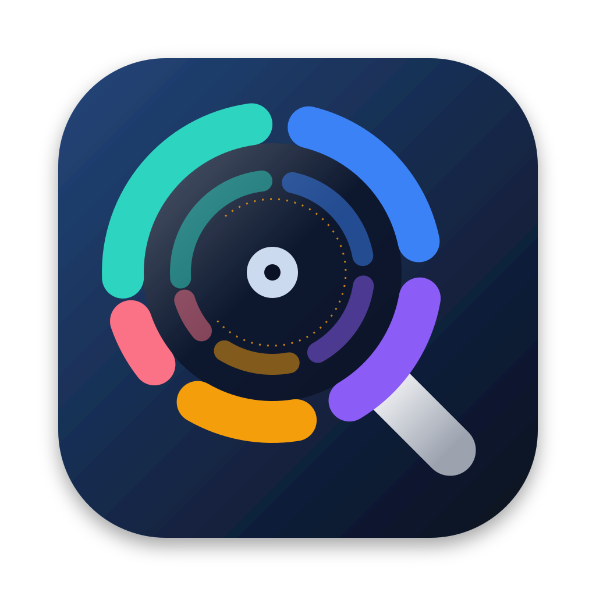

<p align="center"></p>

# MacDiskSleuth

**The disk analyzer that tells you the truth on APFS.**

Every popular disk-usage tool was designed for a filesystem Apple stopped shipping years ago. On modern macOS, copy-on-write clones get double-counted, hard links inflate totals, sparse and compressed files report sizes they don't occupy, and Time Machine local snapshots quietly hold on to space you thought you freed. The result: numbers that don't match Finder, and deletions that don't give you your disk back.

MacDiskSleuth reports what is *really* on disk — and what deleting something will *really* free.

## Three honest size lenses

| Lens | Meaning |
|---|---|
| **Logical** | What the files claim to be (what most tools show) |
| **Physical** | What the disk actually holds — clones, hard links, sparse ranges, and compression counted once |
| **Freeable** | What deleting this would give back *right now* |

An 8 GB video that's a clone of another file shows **8 GB logical, ~0 freeable** — because deleting it frees almost nothing. MacDiskSleuth is the tool that tells you that *before* you empty the Trash and wonder where your space went.

## What's in the box

- `macdisksleuth` — a fast CLI: `scan`, `top`, `recommend`, `info`, `overview`, `snapshots`
- **MacDiskSleuth.app** — a native SwiftUI app with an interactive sunburst, size-lens toggle, delete-to-Trash that shows true freeable bytes, and a "top things to delete" panel with a notification when each scan finishes. Click a recommendation to open it in its own window, or **Fix** it: tick the members to move to the Trash and confirm with Touch ID, Apple Watch, or your password
- `MacDiskSleuthKit` — the shared engine, usable as a Swift package

## Top 5 things to delete

Every scan ends with a ranked list of what to delete first — and a macOS notification, if you ask for one:

```
Top 5 ways to free space  ·  up to 41.2 GB

 1  18.4 GB   Xcode & developer caches   ✓ safe
               ~/Library/Developer/Xcode/DerivedData/MyApp-abc  12.1 GB  · untouched for 7 months
               ~/Library/Developer/CoreSimulator/Caches  4.0 GB  · untouched for 3 weeks
               … 6 more
               Build intermediates, previews and simulator caches that Xcode regenerates on the next build.
               → rm -rf ~/Library/Developer/Xcode/DerivedData  (or Xcode → Settings → Locations → Derived Data → ⓧ)
 2  9.8 GB    Container disk images   ? review first
               ~/Library/Containers/com.docker.docker/Data  9.8 GB  — Docker Desktop
               ⚠ Claims 64 GB but occupies 9.8 GB — sparse or compressed content.
               → docker system prune -a --volumes   (then shrink the image: Docker Desktop → Settings → Resources)
 …
   Skipped 3 large files that are clones or hard links (23 GB logical) — deleting them would free almost nothing.
```

What makes the ranking smart:

- **Freeable bytes, never logical.** Clones and hard links that would free nothing are skipped and reported as skipped; shared bytes that stay on disk are called out.
- **It knows macOS.** A rule base recognises regenerable caches (per app, with the right purge command), Xcode DerivedData and device symbols, package-manager caches, project build artifacts (`node_modules` only next to a `package.json`), Docker/colima/minikube images, VMs, iOS backups, installers, logs, Steam games, render caches — and what must never be touched: Mail, Photos, iCloud Drive and other cloud-synced folders, the OS, `.git`.
- **Staleness.** Modification times roll up the tree, so a cache nobody has touched in a year outranks one written this morning, and Downloads surface only once they are a month old.
- **Duplicates.** Same name and exact size in different folders, and *not* clones — real double storage. The older copy is kept.
- **Safety levels.** `safe` regenerates itself, `likely safe` deserves a glance, `review first` is content only you can judge. Safety and staleness weight the order, so a safe gigabyte beats a gigabyte you'd have to think about.
- **Volume facts.** Local Time Machine snapshots and purgeable space appear when they matter.

```sh
macdisksleuth recommend                      # your home folder, top 5
macdisksleuth recommend / -n 10 --items 5    # whole disk, more detail
macdisksleuth recommend ~ --json             # for scripts
macdisksleuth scan ~ --notify                # scan, then a macOS notification with the top finds
```

Nothing is ever deleted by `recommend` or `scan`. In the app, Move to Trash asks first and shows the honest freeable figure, and Fix requires Touch ID, Apple Watch, or your login password before it moves anything — always to the Trash, never permanently. Apps in `/Applications` or `~/Applications` are pointed out as large but never moved to the Trash by the app — nor is anything else in those folders, or the folders themselves, from recommendations or the inspector; uninstall apps yourself. The same goes for `/Users`, any account folder in it, and your home folder: delete things inside them, never the folder.

Built on `getattrlistbulk` with APFS extended attributes (`PRIVATESIZE`, `CLONEID`, extent flags) — the fast path, with per-file clone/sparse/dataless awareness and zero file opens (iCloud placeholders are never downloaded).

## Install

Requires macOS 14+.

```sh
git clone https://github.com/denmanjohn-maker/macdisksleuth.git
cd macdisksleuth
swift build -c release
.build/release/macdisksleuth --help
```

GUI app:

```sh
brew install xcodegen   # once
make app                # builds App/MacDiskSleuth.xcodeproj → MacDiskSleuth.app
make xcode              # or: generate the project and open it in Xcode
```

> **Building in Xcode?** The `.xcodeproj` is generated, not checked in — run `make xcode` (or `make generate`) first, then build the **MacDiskSleuth** scheme in `App/MacDiskSleuth.xcodeproj`. Opening `Package.swift` at the repo root only gives you the CLI and library targets; the app won't appear there. If command-line builds complain that `xcodebuild` requires Xcode, point developer tools at the full Xcode once: `sudo xcode-select -s /Applications/Xcode.app/Contents/Developer`.

**Finder Quick Action.** MacDiskSleuth.app adds **Analyze with MacDiskSleuth** to Finder: right-click a folder or volume, then choose **Quick Actions**, or **Services** on older layouts. The app opens and scans that folder. To enable it:

1. Copy `MacDiskSleuth.app` to `/Applications` and launch it once so macOS registers the service.
2. If the item doesn't appear, turn it on in **System Settings → Keyboard → Keyboard Shortcuts… → Services → Files and Folders**.
3. Still missing? Refresh the services cache: `/System/Library/CoreServices/pbs -update`, then relaunch Finder (⌥-right-click the Dock icon → Relaunch).

Project page: <https://denmanjohn-maker.github.io/macdisksleuth/>. Prebuilt binaries are on the [Releases](https://github.com/denmanjohn-maker/macdisksleuth/releases) page (see [RELEASING.md](RELEASING.md)). Homebrew formula/cask: coming soon.

## Quick tour

```sh
macdisksleuth info ~/Movies/render.mov   # truth card: 3 sizes, clone family, "deleting frees X"
macdisksleuth scan ~ --top 15            # biggest items, honest sizes, then the top 5 things to delete
macdisksleuth recommend ~                # just the top things to delete, ranked by what deleting really frees
macdisksleuth overview                   # capacity, purgeable space, local snapshots
macdisksleuth snapshots                  # what Time Machine is still holding
```

Filter and sort the rankings:

```sh
macdisksleuth top ~ --ext mov,mp4 --min-size 500MB              # big videos only
macdisksleuth top ~ --only clone --sort freeable,logical         # clones: what deleting really frees
macdisksleuth top ~/Library --include '*cache*' --exclude '.DS_Store'
macdisksleuth top ~ --dirs --min-percent 2 --reverse             # folders ≥ 2% of the total, smallest first
macdisksleuth scan ~ --min-size 1GB                              # fold small items; totals stay true
```

`top` filters: `--min-size`/`--max-size` (e.g. `100MB`, `1.5GiB`), `--min-percent`, `--ext`/`--exclude-ext`, `--include`/`--exclude` (globs; a pattern with `/` matches the full path), and `--only clone,hardlink,sparse,dataless,compressed,shared-outside`. Sort with `--sort` (`logical`, `physical`, `freeable`, `name`, `path` — comma-separated for tiebreaks) and `--reverse`. See `macdisksleuth top --help`.

> **Tip:** grant your terminal Full Disk Access (System Settings → Privacy & Security) for complete results. MacDiskSleuth records every folder it couldn't read and says so, rather than silently under-counting.

## How the accounting works

Shared bytes (clones, hard links) are counted **once, in the deepest folder that contains all files sharing them** — so per-folder numbers are deterministic, nothing is double-counted, and totals match the volume. Full semantics: [docs/truth-engine.md](docs/truth-engine.md).

## License

MIT — see [LICENSE](LICENSE).
